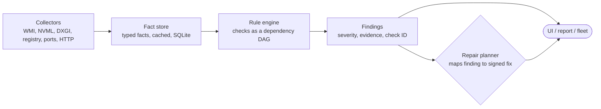
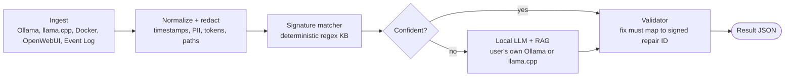
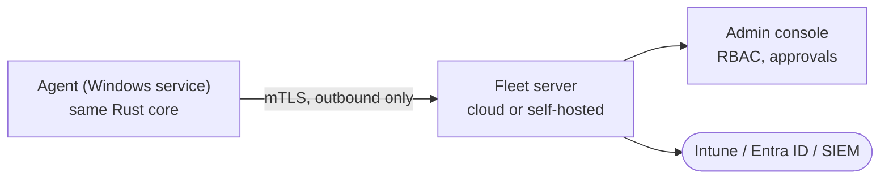
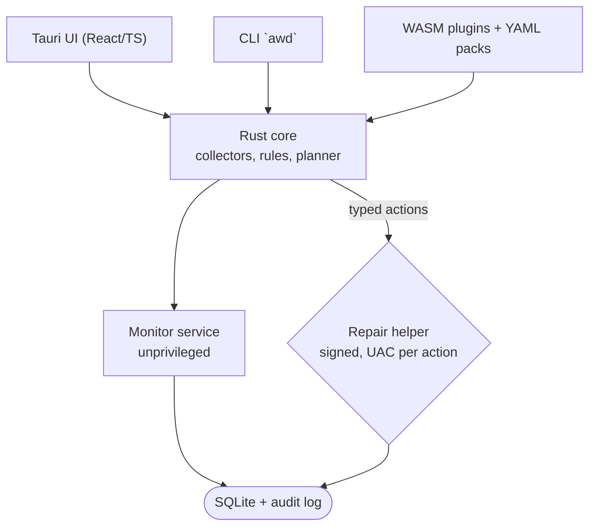

# AI Workstation Doctor: Product Strategy · 產品策略報告

Exported from the strategy Page [AI Workstation Doctor: Product Strategy · 產品策略報告](https://cursor.com/canvas/store-d3b6bee7-8349-4467-b4ab-036b6c5a565d/c3b27734-5bfa-4417-9edf-8667f410fceb).

One positioning, one architecture, one pricing ladder and a 12-month plan to turn the LlamaAutoStart seed into a profitable Windows-first local-AI reliability product. 從 LlamaAutoStart 出發，把它變成能賺錢的 Windows 本地 AI 可靠性產品：一個定位、一套架構、一組定價、一份 12 個月計畫。

## Table of contents · 目錄

- [1. Product Vision · 產品願景](#s1)
- [2. Customer Problems · 客戶痛點](#s2)
- [3. Feature Roadmap · 功能路線](#s3)
- [4. Diagnostic Engine · 診斷引擎](#s4)
- [5. One-Click Repair · 一鍵修復](#s5)
- [6. AI Log Analyzer · AI 日誌分析](#s6)
- [7. Monitoring Dashboard · 監控儀表板](#s7)
- [8. Plugin System · 外掛系統](#s8)
- [9. Enterprise Features · 企業功能](#s9)
- [10. Technical Architecture · 技術架構](#s10)
- [11. Monetization · 營利模式](#s11)
- [12. Competitive Analysis · 競品分析](#s12)
- [13. Upwork Positioning · Upwork 接案定位](#s13)
- [14. 12-Month Roadmap · 12 個月路線圖](#s14)
- [Sources · 資料來源](#sources)

> **Bottom line · 結論**
>
> Keep the name AI Workstation Doctor and sell reliability, not another model runner: diagnose, fix safely, and prove it worked, Windows first. Build a Rust core with a Tauri UI, launch Free plus Pro at US$9 a month, and add a per-device Fleet tier at month 9. Upwork consulting pays the bills until software revenue takes over. 保留「AI Workstation Doctor」這個名字，賣的是「可靠性」而不是另一個模型執行器：診斷、安全修復、驗證成功，先做 Windows。技術用 Rust 核心加 Tauri 介面，先推免費版和每月 9 美元的 Pro，第 9 個月加上按裝置計價的 Fleet 方案。在軟體收入接手前，用 Upwork 接案支撐現金流。所有價格與數字皆為建議或估計。

<a id="s1"></a>

## 1. Product Vision · 產品願景

| Option · 選項 | Buyer clarity | Competition | Pain urgency | Verdict · 判斷 |
| --- | --- | --- | --- | --- |
| AI Workstation Doctor | High | Low, nobody owns 'fix my local AI' | High, the user is stuck now | Pick · 推薦 |
| Local AI Infrastructure Manager | Medium | High, Ollama, LM Studio and LocalAI already 'manage' | Medium | Use later as the Fleet tier story |
| AI DevOps Toolkit | Low | Very high, MLOps vendors | Low | Too vague for a solo founder |
| AI Desktop Operations Platform | Low | Medium | Low | Abstract, weak search intent |

Recommendation: position as "AI Workstation Doctor: the reliability layer for local AI on Windows." People search for symptoms such as "Ollama not using GPU" or "CUDA not detected", not for platforms, so a problem-led name earns cheap traffic and converts at the moment of pain. It also sits beside the runners instead of competing with them, so Ollama, llama.cpp and LM Studio communities become channels, not rivals. The enterprise edition is sold as "Doctor Fleet", which is the Local AI Infrastructure Manager story told to IT.

建議定位：「AI Workstation Doctor：Windows 本地 AI 的可靠性層」。使用者搜尋的是症狀（例如「Ollama 沒用到 GPU」「偵測不到 CUDA」），不是平台，所以以問題命名能帶來低成本流量，並在最痛的時刻成交。它和各個執行器並存而不是競爭，Ollama、llama.cpp、LM Studio 的社群會變成通路而非對手。企業版以「Doctor Fleet」銷售，也就是對 IT 部門講的「本地 AI 基礎設施管理」故事。


<a id="s2"></a>

## 2. Customer Problems · 客戶痛點

Scatter chart data points (estimates; frequency and severity on a 1–5 scale; size = severity × frequency):

| Label | Frequency 頻率 (1-5) | Severity 嚴重度 (1-5) | Size (priority, estimate) |
| --- | ---: | ---: | ---: |
| GPU not utilized | 5 | 4 | 20 |
| VRAM exhaustion | 5 | 4 | 20 |
| CUDA not detected | 4 | 5 | 20 |
| Port conflicts | 4 | 3 | 12 |
| OpenWebUI cannot reach Ollama | 4 | 3 | 12 |
| WSL2 | 3 | 4 | 12 |
| Service not starting | 3 | 4 | 12 |
| Broken Python environments | 3 | 4 | 12 |
| Model downloads failing | 3 | 3 | 9 |
| Disk filled by model caches | 4 | 2 | 8 |
| Firewall: blocked or over-exposed | 2 | 3 | 6 |
| AMD ROCm | 2 | 4 | 8 |

Top 8 problems by priority (severity × frequency, estimates):

| Problem | Priority (estimate) |
| --- | ---: |
| GPU not utilized (silent CPU fallback) | 20 |
| VRAM exhaustion / OOM | 20 |
| CUDA not detected / driver mismatch | 20 |
| Port conflicts (11434, 8080, 1234, 3000) | 12 |
| OpenWebUI cannot reach Ollama | 12 |
| WSL2 / Docker GPU passthrough broken | 12 |
| Service not starting / not auto-starting | 12 |
| Broken Python environments | 12 |

| # | Problem · 問題 | Severity | Frequency | Priority | Typical cause · 常見原因 |
| ---: | --- | ---: | ---: | ---: | --- |
| 1 | GPU not utilized (silent CPU fallback) · GPU 未被使用（默默退回 CPU） | 4 | 5 | 20 | Wrong build, missing CUDA DLLs, `-ngl 0` defaults |
| 2 | VRAM exhaustion / OOM · VRAM 不足 / 記憶體溢出 | 4 | 5 | 20 | Model + context too big for the card |
| 3 | CUDA not detected / driver mismatch · 偵測不到 CUDA / 驅動版本不符 | 5 | 4 | 20 | Driver vs runtime vs toolkit drift |
| 4 | Port conflicts (11434, 8080, 1234, 3000) · 連接埠衝突 | 3 | 4 | 12 | Two runners, zombie process, Hyper-V reserved ranges |
| 5 | OpenWebUI cannot reach Ollama · OpenWebUI 連不上 Ollama | 3 | 4 | 12 | `localhost` inside a container, `OLLAMA_HOST` binding |
| 6 | WSL2 / Docker GPU passthrough broken · WSL2 / Docker GPU 直通失效 | 4 | 3 | 12 | Old WSL kernel, missing NVIDIA container toolkit |
| 7 | Service not starting / not auto-starting · 服務無法啟動或自動啟動 | 4 | 3 | 12 | The exact problem LlamaAutoStart solves |
| 8 | Broken Python environments · Python 環境損壞 | 4 | 3 | 12 | CPU-only torch, pip conflicts, multiple Pythons on PATH |
| 9 | Model downloads failing · 模型下載失敗 | 3 | 3 | 9 | Disk full, proxy, HF auth, partial files |
| 10 | Disk filled by model caches · 模型快取塞滿磁碟 | 2 | 4 | 8 | Duplicate GGUFs across Ollama, LM Studio, HF cache |
| 11 | AMD ROCm / HIP on Windows · Windows 上的 AMD ROCm / HIP | 4 | 2 | 8 | Smaller user base, high frustration |
| 12 | Firewall: blocked or over-exposed · 防火牆：被擋或過度暴露 | 3 | 2 | 6 | Server on 0.0.0.0 with no API key is a security risk |

Scores are my own estimates (priority = severity × frequency), drawn from common issue patterns in the runners' communities, not from a survey. The top three are all GPU-path problems, so the MVP must answer one question in ten seconds: "is my model actually running on the GPU, and if not, why?"

分數是我的估計（優先度 = 嚴重度 × 頻率），依據各執行器社群常見問題歸納，並非調查數據。前三名都是 GPU 路徑問題，所以 MVP 必須在十秒內回答一個問題：「我的模型真的在 GPU 上跑嗎？如果沒有，原因是什麼？」

<a id="s3"></a>

## 3. Feature Roadmap · 功能路線

### MVP (Free + early Pro) · 最小可行產品

| Feature · 功能 | User value | Complexity | Effort | Revenue impact |
| --- | --- | --- | --- | --- |
| System scan: CPU, RAM, GPU, VRAM, disk, driver, CUDA · 系統掃描 | High | Low | 2 wk | Medium (acquisition) |
| Runner detection: Ollama, llama.cpp, LM Studio, OpenWebUI · 執行器偵測 | High | Medium | 2 wk | Medium |
| llama.cpp Manager from LlamaAutoStart · llama.cpp 管理 | High | Low | 1 wk | Medium |
| Ollama Manager: service, `OLLAMA_HOST`, models dir · Ollama 管理 | High | Medium | 2 wk | Medium |
| Port checker and conflict resolver · 連接埠檢查 | High | Low | 1 wk | Low |
| Redacted shareable report (Markdown) · 可分享報告 | High | Low | 1 wk | High (viral loop) |
| Rule-based log analyzer, top 50 signatures · 規則式日誌分析 | High | Medium | 3 wk | High |
| 5 safe one-click fixes with dry-run and undo · 五項安全修復 | High | Medium | 3 wk | High (Pro gate) |

### Professional Edition · 專業版

| Feature · 功能 | User value | Complexity | Effort | Revenue impact |
| --- | --- | --- | --- | --- |
| AI log analyzer on a local LLM · 本地 LLM 日誌分析 | High | High | 4 wk | High |
| Live dashboard with history · 即時儀表板 | High | Medium | 4 wk | High |
| Model-fit advisor: quant and context vs VRAM · 模型適配建議 | High | Medium | 2 wk | High |
| Repair library 30+ with snapshots and rollback · 修復庫 | High | High | 6 wk | High |
| LM Studio, OpenWebUI, Docker and WSL managers · 更多管理器 | Medium | Medium | 3 wk | Medium |
| Benchmarks (tok/s) and regression alerts · 效能基準 | Medium | Medium | 2 wk | Medium |
| Plugin SDK and check packs · 外掛 SDK | Medium | High | 4 wk | Medium |

### Enterprise Edition · 企業版

| Feature · 功能 | User value | Complexity | Effort | Revenue impact |
| --- | --- | --- | --- | --- |
| Fleet console: inventory and health · 機群主控台 | High | High | 8 wk | Very high |
| Remote diagnostics and approved remediation · 遠端診斷修復 | High | High | 6 wk | Very high |
| Signed audit log, SIEM export · 稽核紀錄 | High | Medium | 4 wk | High |
| MSI/MSIX + Intune deployment and policy · Intune 部署 | High | Medium | 3 wk | High |
| Entra ID / AD SSO and RBAC · 單一登入與權限 | Medium | Medium | 3 wk | High |
| Air-gapped, self-hosted server · 離線自架 | Medium | High | 4 wk | High |

Revenue-impact score (0-10, estimates):

| Feature | Revenue-impact score (0-10, estimate) |
| --- | ---: |
| Fleet console | 10 |
| Remote remediation | 9 |
| One-click repair library | 8 |
| AI log analyzer | 8 |
| Model-fit advisor | 7 |
| Live dashboard | 6 |
| Shareable report | 5 |
| System scan | 3 |

The chart shows my estimated revenue-impact score (0-10). Free features drive acquisition; repair and AI analysis drive Pro conversion; fleet features drive almost all large contracts.

上圖是我估計的營收影響分數（0-10）。免費功能負責拉新；修復與 AI 分析帶動 Pro 轉換；機群功能則貢獻幾乎所有大型合約。

<a id="s4"></a>

## 4. Diagnostic Engine Design · 診斷引擎設計



| Layer · 層 | Checks · 檢查項目 | Probe (read-only) · 探測方式 |
| --- | --- | --- |
| Hardware · 硬體 | CPU (AVX2/AVX-512), RAM, GPU model, VRAM free/total, disk free on model drives | WMI `Win32_Processor`, `Win32_VideoController`, NVML or `nvidia-smi`, DXGI for AMD/Intel VRAM, `GetDiskFreeSpaceEx` |
| CUDA | Driver CUDA version vs runtime vs toolkit, `CUDA_PATH`, cuBLAS DLLs on PATH | `nvidia-smi`, `nvcc --version`, DLL search order scan |
| ROCm / HIP | HIP SDK present, supported GPU, `HIP_PATH` | `hipInfo`, registry, PATH |
| Python | All interpreters, venv health, `pip check`, torch CUDA build | `py -0p`, `python -c "import torch; print(torch.cuda.is_available())"` |
| Node.js / Docker / WSL | Versions, Docker engine up, GPU in containers, WSL kernel | `node -v`, `docker info`, `wsl -l -v`, `docker run --gpus all` smoke test (opt-in) |
| Ollama | Service, `OLLAMA_HOST`, port 11434, models dir, GPU offload | `GET /api/version`, `GET /api/ps`, log tail |
| llama.cpp | Build type (CUDA/Vulkan/CPU), `-ngl`, port, autostart task | `/health`, `/v1/models`, scheduled task query |
| LM Studio | Server on 1234, runtime selected, models dir | `GET /v1/models`, config files |
| OpenWebUI | Container up, can reach backend, data volume | `docker inspect`, HTTP to backend from inside container |
| vLLM | WSL/Linux only, CUDA in WSL, port 8000 | `/v1/models`, `nvidia-smi` inside WSL |

```yaml
id: ollama.gpu_offload
title: Ollama is running models on the GPU
depends_on: [gpu.nvidia.present, ollama.service.running]
collect:
  - http: { url: "http://127.0.0.1:11434/api/ps" }
evaluate: "all(m.size_vram > 0 for m in models)"
severity: high
evidence: [models[].name, models[].size_vram]
fixes: [ollama.set_gpu_layers, cuda.repair_dll_path]
```

- Checks are declarative YAML with a dependency graph, so a failed driver check skips 20 downstream checks instead of reporting 20 errors.
- Every probe is read-only, time-boxed (2 s default) and runs in parallel; a full scan should finish under 10 seconds.
- Facts are versioned so the fleet console can diff a machine against yesterday or against a golden baseline.
- Each check ID is stable and public, which becomes the SEO surface: one docs page per check ID.

建議：檢查項目以宣告式 YAML 撰寫並形成相依圖，驅動程式檢查失敗時直接略過下游 20 項，而不是報出 20 個錯誤。所有探測皆唯讀、有時間上限並平行執行，完整掃描應在 10 秒內完成。事實資料有版本，機群主控台可以和昨天或標準基準比對。每個檢查 ID 固定且公開，每個 ID 一頁文件，就是最好的 SEO。

<a id="s5"></a>

## 5. One-Click Repair System · 一鍵修復系統

1. **Detect · 偵測** — A finding with evidence triggers a candidate fix from the signed repair catalog.
2. **Plan and dry-run · 規劃與試跑** — Show the exact diff: env vars, registry keys, files, services, firewall rules, commands.
3. **Consent · 同意** — User approves per plan; Fleet requires an approver role for remote runs.
4. **Snapshot · 快照** — Back up every touched item (env, `reg export`, files, rule XML); create a restore point for driver-level changes.
5. **Elevate per action · 逐項提權** — Only the step that needs admin goes to a signed helper via UAC; the app itself never runs elevated.
6. **Execute idempotently · 冪等執行** — Each step checks state first, so re-running is safe.
7. **Verify · 驗證** — Re-run the original check; success means the finding is gone.
8. **Rollback or record · 回滾或記錄** — Auto-restore the snapshot on failure; write a hash-chained audit entry either way.

| Issue · 問題 | Repair · 修復 | Admin? | Risk | Rollback |
| --- | --- | --- | --- | --- |
| CUDA install issues | Detect driver/runtime mismatch; download matching runtime DLLs into the runner's folder; guide driver update (never silent driver install) | Driver only | High | Restore point + DLL backup |
| PATH configuration | Dedupe, reorder, remove dead entries; user PATH before machine PATH | Machine PATH only | Medium | Saved PATH value |
| Broken Python packages | Create fresh venv, reinstall torch with correct CUDA index URL; never touch system Python | No | Low | Old venv kept, renamed |
| Service startup failures | Re-register logon task or service, fix working dir and env, add health-check restart | Service only | Low | Exported task XML |
| Occupied ports | Identify owning PID and app; offer stop, or move runner to a free port and update clients | Sometimes | Low | Previous config |
| Firewall rules | Scoped rule per runner, private profile only, localhost by default; warn on 0.0.0.0 with no API key | Yes | Medium | Rule XML export |
| Missing runtime deps | Install VC++ redistributable, WSL update, NVIDIA container toolkit via winget with hash check | Yes | Low | Uninstall entry |

**Safety rules · 安全原則**

- Dry-run first, always; the plan is the contract
- Least privilege: per-action UAC through a separate signed helper
- Only signed repair plugins run; unsigned ones are view-only
- Append-only, hash-chained audit log (JSONL) with before/after
- Automatic rollback when verification fails

**Never do · 絕對不做**

- Silent driver installs or BIOS changes
- Disabling the firewall or Defender as a 'fix'
- Deleting model files without a recycle-bin step
- Running downloaded scripts that are not hash-pinned
- Elevating the whole UI process

Note: Windows limits restore-point creation frequency by default, so the tool cannot rely on a fresh restore point for every fix; item-level snapshots are the primary safety net and restore points are reserved for driver-level work.

修復流程：偵測 → 試跑顯示差異 → 使用者同意 → 快照 → 只對需要的步驟用 UAC 提權 → 冪等執行 → 重跑檢查驗證 → 失敗自動回滾，並寫入雜湊鏈稽核紀錄。Windows 預設會限制還原點建立頻率，所以不能每次修復都依賴還原點；主要防線是逐項快照，還原點只用於驅動層級的變更。

<a id="s6"></a>

## 6. AI-Powered Log Analyzer · AI 日誌分析



```json
{
  "source": "llama.cpp",
  "window": "2026-11-19T17:02:10+08:00/17:02:40+08:00",
  "root_cause": "CUDA out of memory while allocating KV cache: ctx 32768 on an 8 GB GPU",
  "evidence": ["ggml_cuda_host_malloc: failed to allocate 4096.00 MiB"],
  "confidence": 0.92,
  "confidence_basis": "signature match llama.oom.kv_cache + VRAM fact 7.6/8.0 GB",
  "suggested_fix": "Lower context to 8192 or use q8_0 KV cache; or pick a Q4_K_M quant",
  "automated_repair": { "id": "llamacpp.set_ctx", "params": { "ctx": 8192 },
                        "requires_admin": false, "reversible": true },
  "engine": "signature",
  "sent_off_device": false
}
```

- Local-LLM-first privacy: logs never leave the machine by default; the analyzer uses a small model on the runner the user already has.
- Cloud fallback is opt-in per incident and shows the redacted payload before sending.
- Confidence combines signature strength, matching facts and LLM self-agreement over 3 samples; below 0.6 the UI says 'possible cause' and offers no automatic repair.
- The LLM can only propose repair IDs from the signed catalog, never free-form commands.
- Every confirmed fix feeds a new signature back into the knowledge base, so the LLM path shrinks over time.

輸出固定四個欄位：根本原因、信心分數、建議修復、自動修復選項。預設「本地 LLM 優先」，日誌不離開電腦，使用使用者已安裝的執行器跑小模型；雲端分析需逐次同意並先顯示遮蔽後內容。信心低於 0.6 只標示「可能原因」且不提供自動修復。LLM 只能從已簽章修復目錄中選擇 ID，不能產生任意指令。

<a id="s7"></a>

## 7. Monitoring Dashboard · 監控儀表板

| Panel · 面板 | Shows · 內容 | Source · 來源 |
| --- | --- | --- |
| Health strip · 健康列 | One status per runner: running, degraded, stopped, with check ID | Rule engine |
| Active models · 使用中模型 | Model, quant, context, GPU vs CPU layers, keep-alive | `/api/ps`, `/slots`, `/v1/models` |
| Throughput · 吞吐量 | Tokens/s prompt and generation, last 1 h | Runner metrics endpoints, log parsing |
| GPU · 顯示卡 | Utilization, VRAM used/total, temperature, power | NVML / DXGI, 1 s sampling |
| Memory · 記憶體 | RAM, commit, pagefile pressure | Performance counters |
| Alerts · 警示 | New findings with one-click 'Explain' and 'Fix' | Analyzer + rules |

- Answer-first layout: the top line reads 'All good' or names the one problem, before any chart.
- Tray icon with color state; most users never open the full window.
- Every alert has Explain, Fix (dry-run) and Copy report; no dead-end red text.
- Sample at 1 s, keep 24 h locally in SQLite; under 1% CPU and 80 MB RAM as a budget.
- Dark mode, keyboard shortcuts, and Traditional Chinese / English from day one, which is a real edge in Taiwan and APAC.

UX 建議：先給答案，最上方直接顯示「一切正常」或指出唯一問題；工具列圖示用顏色表示狀態；每個警示都附「說明」「修復（試跑）」「複製報告」；每秒取樣、本地保存 24 小時，資源預算為 CPU 1% 以下、記憶體 80 MB 以下；一開始就支援繁中與英文，這在台灣與亞太是實際優勢。

<a id="s8"></a>

## 8. Plugin System · 外掛系統

| Tier · 層級 | Format | Can do · 能做 | Isolation | Who |
| --- | --- | --- | --- | --- |
| 0. Check packs | YAML + regex signatures | New checks, log signatures, docs links | No code runs | Community, anyone |
| 1. WASM plugins | WebAssembly + manifest | New runner adapters, custom diagnostics, read-only probes | Sandbox, declared capabilities only | Developers |
| 2. Signed repair plugins | WASM + signed manifest | Repairs through the helper's typed actions | Code signing + review | Vetted partners |
| 3. Integration services | Out-of-process gRPC | SIEM, ServiceNow, Slack/Teams, CMDB | Separate process, enterprise only | Enterprise, you |

```yaml
name: vllm-runner
version: 0.3.1
kind: runner-adapter
capabilities:
  net: ["127.0.0.1:8000"]
  exec: []            # no process spawning
  repair_actions: []  # read-only plugin
checks: [vllm.health, vllm.gpu_memory_utilization]
signature: ed25519:...
```

Extensibility strategy: make Tier 0 so easy that every solved support ticket becomes a check pack. Repairs never call the OS directly; they call typed helper actions (set env var, write firewall rule, restart service), which is what makes third-party repairs auditable and reversible. A curated marketplace with a 70/30 revenue share comes after 1,000 active Pro users, not before.

擴充策略：讓第 0 層簡單到每張解決的支援單都能變成檢查包。修復外掛不直接呼叫作業系統，只能呼叫具型別的輔助動作（設定環境變數、寫防火牆規則、重啟服務），因此第三方修復也能稽核與回滾。精選市集（70/30 分潤）等到有 1,000 位 Pro 活躍使用者後再做。

<a id="s9"></a>

## 9. Enterprise Features · 企業功能

| Rank | Feature · 功能 | Customer value | Why IT pays · 付費原因 |
| ---: | --- | ---: | --- |
| 1 | Fleet management · 機群管理 | 10 | Inventory of every AI workstation, GPU, runner and model in one view |
| 2 | Remote diagnostics · 遠端診斷 | 9 | Cuts a desk visit to a 2-minute report |
| 3 | Compliance logging · 合規紀錄 | 8 | Who ran which model, which fix, when; exportable for audits |
| 4 | Intune integration · Intune 整合 | 8 | MSI/MSIX deploy, config profiles, compliance signals |
| 5 | Remote remediation · 遠端修復 | 7 | High value but needs trust; ship with approver workflow and rollback |
| 6 | Multi-machine dashboards · 多機儀表板 | 7 | GPU utilization across the team shows waste and buying needs |
| 7 | Active Directory / Entra ID · 目錄整合 | 6 | SSO, RBAC, group-based policies |



企業功能依客戶價值排序：機群管理、遠端診斷、合規紀錄、Intune 整合、遠端修復、多機儀表板、AD/Entra ID。代理程式只做對外 mTLS 連線，不開放入站連接埠，這是 IT 安全審查最容易通過的設計。遠端修復價值高但需要信任，所以一定搭配審核流程與回滾。

<a id="s10"></a>

## 10. Technical Architecture · 技術架構

| Option | Windows API depth | Footprint | Memory safety | Your dev speed | Fleet agent reuse | Verdict · 判斷 |
| --- | --- | --- | --- | --- | --- | --- |
| Python | Medium (pywin32, wmi) | Large (bundled runtime) | Yes | Fastest | Weak | Prototype only · 只做原型 |
| Rust | Deep (windows-rs, NVML) | Small | Yes | Slower at first | Excellent, one binary | Core pick · 核心推薦 |
| Go | Medium | Small | Yes (GC) | Fast | Excellent | Good fleet-server choice |
| C# / .NET | Deepest (WMI, EventLog, services, MSI) | Medium | Yes | Fast | Good | Strong runner-up |
| Electron | Via Node addons | Very large (100 MB+) | n/a (UI shell) | Fast UI | None | Avoid for a diagnostics tool |

| Item | Recommendation |
| --- | --- |
| Desktop UI · 介面 | Tauri 2 with React + TypeScript (small installer, system WebView2) |
| Core / backend · 核心 | Rust crate: collectors, rule engine, repair planner; shared by app, CLI and fleet agent |
| Service layer · 服務層 | Unprivileged Windows service for monitoring + separate signed elevated helper for repairs, named-pipe IPC with ACLs |
| Logging · 紀錄 | `tracing` with JSON output, rotating files, hash-chained audit stream, optional OpenTelemetry export |
| Plugins · 外掛 | YAML check packs + WASM (wasmtime) with capability manifests; gRPC for enterprise integrations |
| Storage · 儲存 | SQLite for facts, metrics and history |
| Auto-update · 自動更新 | Tauri updater with signed releases, staged channels (beta, stable); MSI/MSIX for Intune-managed fleets |
| Fleet server · 機群伺服器 | Go or Rust + Postgres; Docker image for self-hosting |



Recommended architecture: Rust core with a Tauri UI. A diagnostics tool that runs privileged repairs must be small, fast to start and memory-safe, and the same Rust binary becomes the fleet agent later. Keep Python for months 1-2 to reuse LlamaAutoStart and validate demand, then port the proven checks. C#/.NET is a credible alternative if Windows-only forever; Electron is too heavy for a tool people install when their machine is already struggling.

推薦架構：Rust 核心加 Tauri 介面。會執行特權修復的診斷工具必須小、啟動快、記憶體安全，而且同一個 Rust 執行檔之後就是機群代理程式。第 1-2 個月先用 Python 沿用 LlamaAutoStart 驗證需求，再移植已驗證的檢查。若永遠只做 Windows，C#/.NET 也是合理選項；Electron 太重，不適合在電腦已經出問題時才安裝的工具。

<a id="s11"></a>

## 11. Monetization · 營利模式

| Model · 模式 | Pros | Cons | Use? · 採用 |
| --- | --- | --- | --- |
| Free | Fast adoption, community | No revenue | Yes, as the funnel |
| Freemium | Diagnose free, pay to fix: value at the moment of pain | Must keep free tier useful | Core model |
| One-time license | Enthusiasts like it, early cash | No recurring revenue | Only as a limited founder deal |
| Subscription | Recurring, funds the signature KB | Churn if nothing breaks | Yes, Pro and Fleet |
| Enterprise licensing | Large contracts | Long sales cycles | From month 9 |
| Consulting | Cash now, finds real problems | Doesn't scale | Yes, months 1-12 via Upwork |

| Tier (recommended) · 方案 | Price · 價格 | Includes · 內容 | Target |
| --- | --- | --- | --- |
| Community · 社群版 | Free | Full scan, port checker, llama.cpp + Ollama managers, shareable report, rule-based log hints | Enthusiasts |
| Founder Lifetime · 創始終身 | US$79 one-time, first 500 buyers | Pro features, 2 machines, updates for life of v1 | Early adopters |
| Pro · 專業版 | US$9/month or US$79/year | One-click repairs with rollback, AI log analyzer, dashboard history, model-fit advisor, 3 machines | Developers, AI engineers |
| Fleet · 機群版 | US$8/device/month, minimum 5 devices | Fleet console, remote diagnostics, team alerts, approvals | Small businesses, labs |
| Enterprise · 企業版 | From US$6,000/year (up to 100 devices) | Self-hosted, Intune/MSI, Entra ID SSO, audit export, remote remediation, SLA | IT departments |

Base-case monthly revenue estimates (US$):

| Month | Software MRR · 軟體月經常性收入 (US$, estimate) | Consulting revenue · 接案收入 (US$, estimate) |
| --- | ---: | ---: |
| M1 | 0 | 500 |
| M2 | 0 | 800 |
| M3 | 0 | 1000 |
| M4 | 150 | 1200 |
| M5 | 400 | 1500 |
| M6 | 900 | 1500 |
| M7 | 1500 | 1800 |
| M8 | 2200 | 2000 |
| M9 | 3000 | 2000 |
| M10 | 3900 | 2200 |
| M11 | 5000 | 2500 |
| M12 | 6200 | 2500 |

All prices are recommendations and the chart is my base-case estimate in US$ per month, not a forecast from market data. Pro at US$9 sits at Docker Pro's annual price, which developers already accept; Fleet per-device pricing matches how IT budgets endpoints.

所有價格皆為建議，圖表為我估計的基準情境（每月美元），並非市場數據預測。Pro 定在每月 9 美元，與開發者已接受的 Docker Pro 年繳價格相同；Fleet 按裝置計價，符合 IT 部門編列端點預算的方式。

<a id="s12"></a>

## 12. Competitive Analysis · 競品分析

Coverage scores 0–3 (estimates):

| Product | Cross-runner diagnostics | One-click repair | GPU/CUDA health | Log root cause | Windows depth | Fleet mgmt |
| --- | ---: | ---: | ---: | ---: | ---: | ---: |
| Ollama | 0 | 0 | 1 | 0 | 1 | 0 |
| LM Studio | 0 | 0 | 2 | 0 | 1 | 0 |
| OpenWebUI | 1 | 0 | 0 | 0 | 0 | 1 |
| Docker Desktop | 0 | 1 | 1 | 0 | 2 | 2 |
| LocalAI | 1 | 0 | 1 | 0 | 0 | 1 |
| AI Workstation Doctor | 3 | 3 | 3 | 3 | 3 | 2 |

| Product | Verified facts · 已查證事實 | Gap where Doctor wins · 切入點 |
| --- | --- | --- |
| Ollama | MIT licensed; free for personal and commercial use; desktop app with built-in chat | Doesn't diagnose other runners or the Windows layer under it |
| LM Studio | Free for work since July 2025; terms allow personal and internal business use, no resale or hosting it as a service | Fixes its own runtime only; no fleet, no repair of CUDA, PATH, ports |
| OpenWebUI | Since v0.6.6 (April 2025) the license requires keeping Open WebUI branding for deployments over 50 users unless enterprise-licensed | A UI, not an ops tool; 'cannot connect to Ollama' is our ticket |
| Docker Desktop | Paid subscription required at 250+ employees or US$10M+ revenue; Business US$24/user/month on annual billing | Proves IT pays per seat for developer tooling; no AI-runner awareness |
| LocalAI | MIT licensed Go server with OpenAI and Anthropic compatible APIs and 80+ backends | Another runtime to manage; Doctor manages it rather than replacing it |

Heatmap scores (0-3) are my own estimates of each product's coverage. The winning gap is the space between tools: nobody owns cross-runner diagnosis plus safe repair on Windows. Facts in the table come from the vendors' own pages, listed in the sources.

熱圖分數（0-3）是我對各產品涵蓋程度的估計。真正的空白在工具之間：沒有人負責「跨執行器診斷 + Windows 安全修復」。表中事實取自各廠商官方頁面，列於資料來源。

<a id="s13"></a>

## 13. Upwork Positioning · Upwork 接案定位

| Service · 服務 | Package (recommended price) | Deliverable · 交付 | Target customer · 目標客戶 |
| --- | --- | --- | --- |
| Local LLM setup · 本地 LLM 架設 | US$150-300 fixed | Ollama or llama.cpp + OpenWebUI on one Windows PC, autostart, docs | Solo pros, consultants, privacy-minded users |
| GPU optimization · GPU 最佳化 | US$250-500 fixed | Benchmark, quant and context tuning, before/after tok/s report | Developers, small AI teams |
| AI infra troubleshooting · 問題排除 | US$40-60/hour, 1 h minimum | Root cause + fix + Doctor report | Anyone stuck right now |
| Enterprise AI deployment · 企業部署 | US$1,500-5,000 project | On-prem Ollama/vLLM + OpenWebUI for 10-50 users, SSO, backups | Accounting and law firms, clinics, Taiwan manufacturers |
| Workstation automation · 工作站自動化 | US$200-600 fixed | Scheduled tasks, services, scripts like LlamaAutoStart, Windows network recovery | IT admins, small offices |

- **Headline** — Local AI on Windows, set up and fixed: Ollama, llama.cpp, CUDA, OpenWebUI
- **Proof** — Public repos: LlamaAutoStart, Windows-Network-Recovery-Toolkit, AI Workstation Doctor reports
- **Niche edge** — Accounting background + bilingual Mandarin/English: private AI for finance and professional firms in Taiwan and APAC
- **Flywheel** — Every client job runs the Doctor scan, and every new problem becomes a check pack

Prices are recommendations for a newer Upwork profile; raise them after 5-10 five-star reviews. Lead with fixed-price packages, because buyers in pain want a known cost. Your accounting and systems background is the differentiator: private, on-prem AI for firms that cannot send client data to the cloud.

以上價格是給較新 Upwork 檔案的建議，累積 5-10 個五星評價後再調高。以固定價格方案為主，因為急著解決問題的客戶想知道確定成本。你的會計與系統背景就是差異化：為不能把客戶資料送上雲端的事務所提供私有、地端 AI。

<a id="s14"></a>

## 14. 12-Month Product Roadmap · 12 個月路線圖

| Month | Build · 開發 | Go-to-market · 市場 | Goal (estimate) · 目標 |
| --- | --- | --- | --- |
| M1 | Python prototype: scan + port checker + LlamaAutoStart as llama.cpp Manager | Upwork packages live; post the free scanner on GitHub | 3 consulting clients |
| M2 | Ollama Manager, 25 checks, Markdown report | Reddit r/LocalLLaMA, Ollama Discord posts with real fixes | 300 downloads |
| M3 | Rust core + Tauri shell; port proven checks; signature KB v1 (50) | Docs site: one page per check ID | 1,000 downloads, 100 waitlist |
| M4 | 5 safe repairs with dry-run, snapshot, rollback; signed helper | Founder Lifetime US$79 launch | 50 founder sales |
| M5 | Pro launch: repair library 15, dashboard v1 | Product Hunt + bilingual YouTube demos | 40 Pro subscribers |
| M6 | Local-LLM log analyzer, model-fit advisor | Partner with Taiwan AI meetups, PTT, Threads | 100 Pro |
| M7 | LM Studio, OpenWebUI, Docker/WSL managers; benchmarks | Case studies from consulting clients | 170 Pro |
| M8 | Check-pack format public; community packs | Contributor program | 250 Pro |
| M9 | Fleet beta: agent service + hosted console | 5 design partners from consulting | First Fleet pilots |
| M10 | Remote diagnostics, approvals, audit log | Fleet paid launch US$8/device | 100 managed devices |
| M11 | MSI/Intune package, Entra ID SSO | Outbound to SMB IT, MSPs in Taiwan | First enterprise pilot |
| M12 | Self-hosted server, SIEM export, SOC 2 readiness plan | Annual plans, reseller and MSP terms | US$6,000+ software MRR |

> **Founder checkpoint · 創辦人檢查點**
>
> Gate the Rust rewrite on demand: if month 2 shows fewer than 300 downloads, keep iterating the Python version and the content, not the architecture. Goals are my estimates, not forecasts. 以需求決定是否改寫成 Rust：如果第 2 個月下載量少於 300，就繼續改進 Python 版本與內容，而不是架構。目標是我的估計，並非預測。

1. Next action: rename LlamaAutoStart's repo plan into `ai-workstation-doctor` and add a `scan` command. 下一步：規劃把 LlamaAutoStart 擴充為 `ai-workstation-doctor`，加入 `scan` 指令。
2. Publish three fixed-price Upwork packages this week. 本週上架三個 Upwork 固定價格方案。
3. Log every problem you fix as a future check ID. 把每個修好的問題記錄成未來的檢查 ID。

<a id="sources"></a>

## Sources · 資料來源

- https://lmstudio.ai/blog/free-for-work
- https://lmstudio.ai/app-terms
- https://docs.openwebui.com/license.md
- https://www.docker.com/pricing/
- https://docs.docker.com/subscription-billing/desktop-license
- https://github.com/mudler/LocalAI
- https://localai.io/docs/start/overview/
- https://github.com/open-webui/docs/blob/main/docs/alternatives/ollama.mdx
